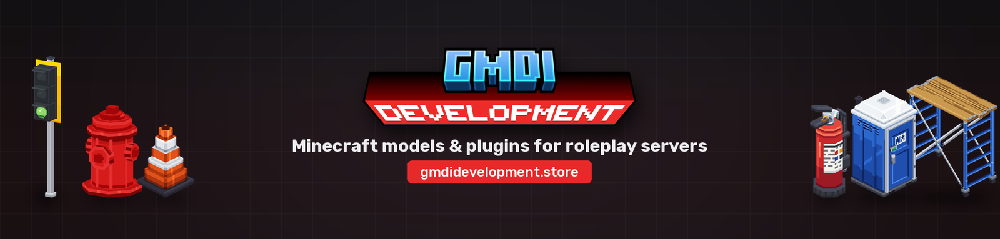
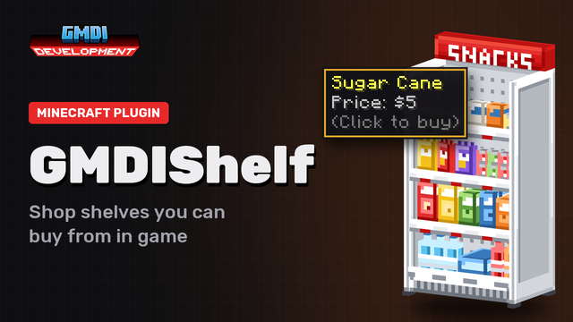

<h3 align="center">Hi, I'm Gabriele</h3>

18, from Italy, final year of Computer Science at high school. 
I make Minecraft plugins in Java and models, textures and resource packs in Blockbench, 
mostly for roleplay servers, under the name <b>GMDI Development</b>.

 

### Plugins

<table>
<tr>
<td width="33%"></td>
<td width="33%"></td>
<td width="33%"></td>
</tr>
<tr>
<td><b>GMDIStreaming</b> Cameras that stream live onto in-game TVs.</td>
<td><b>GMDIShelf</b> Shop shelves with hover tooltips, discounts and a buy GUI.</td>
<td><b>GMDIClaw</b> A working claw machine with configurable prizes.</td>
</tr>
</table>

### Models

Road signs and traffic lights, a Milan metro, a construction set, roleplay packs for police, fire station, bank,
prison and EMS, plus vehicles animated with ModelEngine. All on [gmdidevelopment.store](https://gmdidevelopment.store).

### Also

[**Wifora**](https://github.com/GabryOsas/Wifora): streams your PC's audio to any phone on the same Wi-Fi, straight in the browser.
